# Flagship e-Wallet Program (Web now, Mobile next) — Design

Status: **draft for review** (builder-checked; your answers of 23 Nov recorded). Approach C confirmed. Waiting only for your approval of the document. Everything marked *(my call)* is a proposal you can overturn.

All technical design (architecture, database, diagrams, Docker, Git, CI) lives in this one document; diagrams are Mermaid and render on GitHub and in IntelliJ. Companion: the visual plan (personas, roadmap, data map, user stories, journeys, code audit) lives on the Design canvas "e-Wallet Product Plan". This document is the written design that implementation plans are built from; the canvas is the picture of it.

## Intent and why

Turn the existing e-wallet (Spring Boot backend, React frontend, PostgreSQL `e_walletDB`) into a flagship web product for three audiences (customers, agents, back-office staff) that feels instant and certain to use and is provably correct with money. The same backend then serves a mobile app with no rewrite.

**Why:** a mind-blowing e-wallet that works as a **portfolio project and a pitch demo first**, and later handles real money *(your answer, 23 Nov)*. So the near-term bar is: every flow can be shown end to end, convincingly, with nothing faked on screen, while the money core is already built to a standard that real money won't force a rewrite of. Outside services come from **Plaid in Sandbox** for now (KYC and a bank top-up demo).

## Where we start (audit of GitHub `main`, 23 Nov 2026)

Backend `E-wallet-backend@84f2bc1` (20 Nov), frontend `E-wallet-frontend@c861197` (5 Nov).

| Area | State | Notes |
|---|---|---|
| Onboarding & auth | Built | Customer self-registration (NIDA, DOB, address), OTP 6 digits / 5 min / 5 attempts, set/change/forgot/reset PIN, JWT 15 min + 7-day refresh, sessions, logout |
| Roles, staff, permissions | Built | One role per user, permissions grouped into `modules`, staff CRUD, agents with business/TIN/region/district |
| Wallets & ledger | Built | 7 `WalletType`s; `PESSIMISTIC_WRITE` locks; `LedgerService.postJournal` rejects unbalanced journals |
| Treasury & float | Built | Mint, commission top-up, agent float requests with approve/reject; 27 tests |
| Agent cash-in / cash-out | Partial | Correct journals and `transactions` rows; **customer PIN passes through the agent's request**; no tests; no idempotency |
| Tariffs | Partial | Bands + applicable lookup; no management endpoints/UI |
| Customer money features | Missing | No P2P transfer, no customer history/receipts, no notifications |
| Frontend | Partial | Auth screens call the API. All 10 staff dashboard pages and both customer pages read hard-coded `data.ts`. Frontend calls `/auth/customer-registration` (backend serves `/customers/register`) and uses role `CASHIER` (backend renamed to `AGENT` in V16) |

## Decisions already made (carried forward from earlier specs, not re-opened)

1. PIN is the only credential; no passwords anywhere.
2. One role per user.
3. The dev database may be dropped and rebuilt; migrations are forward-only Flyway files.
4. `transactions` is the customer-facing record; `transaction_journal`/`_line` is the ledger of truth. Every money movement writes both, in one DB transaction.
5. Business timezone is `Africa/Dar_es_Salaam`; currency TZS.
6. Live dashboards poll; no WebSocket infrastructure unless a feature needs push.

**Decided on 23 Nov (your answers)**

7. Audience: portfolio and pitch demo first, real money later.
8. Outside provider: Plaid, in Sandbox. KYC uses Plaid Identity Verification.
9. Withdrawals are customer-initiated: the customer confirms on their own phone with their own PIN, and the agent never sees it.
10. Limits are tiered by KYC result: unverified and verified customers get different limits (demo amounts in Phase 1).

## Goals

- A customer can register, get funded at an agent (cash-in), send, withdraw and prove a payment without staff help, in under 3 minutes for first use and 3 taps + PIN for a send.
- Every screen a user sees shows real data from the API.
- Money cannot be created, lost or double-posted: journals balance, retries are safe, issuance needs two people, reconciliation runs daily.
- Pitch-ready: a scripted demo (register → verify with Plaid → add money → send → withdraw at agent → staff sees it live) runs end to end on seeded data.
- One versioned API (`/api/v1`) documented well enough that a mobile client needs no backend changes beyond device/push endpoints.

## Non-goals

- Loans (the frontend page has no backend and no design; hide it until it has a spec of its own).
- Real bank transfers, card or mobile-money top-up, merchant payouts, multi-currency. Funding is agent cash-in, plus a Plaid Sandbox bank top-up that is clearly labelled as a demo.
- Licensing, regulatory approval and production KYC/payment contracts for real money in Tanzania. Planned for later; the design keeps providers swappable.
- Replacing the existing ledger, wallet model, or auth model.

## Anti-goals (would be failure even if it "works")

- Any flow where one party can see or enter another party's PIN.
- A dashboard that looks live but shows sample data.
- A feature that moves money without a balanced journal, a `transactions` row, and a test proving both.
- A web-only shortcut that the mobile app would have to undo.
- A demo flow that could be mistaken for real money movement (Sandbox flows are labelled on screen and on receipts).

## Constraints

- Stack stays: Spring Boot 4.2 / JPA / Flyway / PostgreSQL; React 19 / Vite / TypeScript / Tailwind 4 / React Router 7 / Formik + Yup.
- Money columns stay `NUMERIC`; balances change only inside the posting path that also writes the journal.
- Work lands as small, separately reviewable specs + plans per phase (this document is the umbrella; each phase gets its own spec in this folder before it is built).
- Test-first for anything that moves money (superpowers TDD).

## Approaches

Three orderings were considered. All end in the same place; they differ in what is true after the first few weeks.

**A. Harden first.** Fix the cash-out PIN flow, idempotency, tests and frontend drift; then build customer features; then polish.
*Trade-off:* safest; little that is new to show for the first stretch.

**B. Show first.** Wire dashboards to real data and build send-money with a polished customer UI; harden later.
*Trade-off:* fastest to impress; builds new money flows on top of known gaps (untested postings, no idempotency, PIN exposure) and risks demoing something unsafe.

**C. Secure core, then visible wins (recommended, my call).** A short Phase 0 that fixes only what touches money safety and drift (PIN flow, idempotency, tests, role/path drift), immediately followed by the most visible customer win (send money + history + receipts), with dashboards wired in parallel by page.
*Why:* the hardening items are small and every later money feature reuses them (idempotency, lock order, test fixtures), so doing them first is cheaper than retrofitting. Dashboard wiring is independent per page, so it runs alongside without blocking.

**In plain words:** all three reach the same finished app. They only differ in what gets built first. A fixes the hidden safety problems before anything new. B builds the impressive screens first and fixes safety later. C does a short safety fix (about a week and a half), then goes straight to the impressive parts.

**Picked:** C *(your decision, 23 Nov)*, my recommendation for a portfolio and pitch. A reviewer or investor who tries to break the demo (double-tapping *Send*, asking where the customer PIN goes) gets a good answer, and the visible features still arrive early. *Confirmed by you, 23 Nov.*

### Delivery timeline (approach C, indicative)

Assumes a start on Monday 30 Nov 2026 and a small team. Dates move once the approach and team size are confirmed.

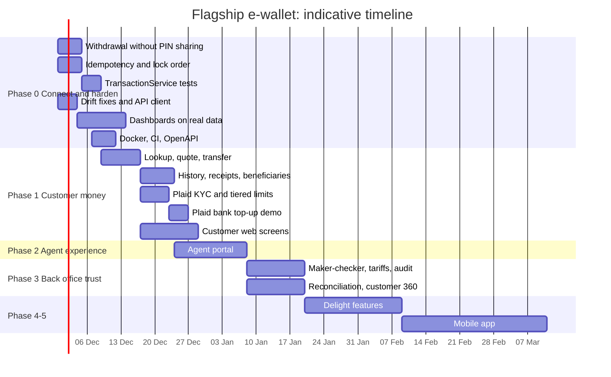

## Design

### Money movement model *(agreed 25 Nov, your answers)*

**One rule:** every shilling in a wallet is backed by a real shilling in WalletPesa's escrow (trust) bank account, as Tanzania's e-money rules require. Wallet money is created only when real money arrives in escrow, and leaves only when escrow pays it out. A daily check confirms that **all wallet balances added together = escrow balance**.

Who does what:
- **WalletPesa's ledger** records who owns what inside the wallet. It is the record of truth.
- **Plaid (Sandbox)** plays "the bank side" in the demo. It checks identity (IDV), reads linked bank balances (Auth + Balance), and, for every bank movement, the backend posts the matching line on the Sandbox account with `/sandbox/transactions/create`: a debit (positive amount) when money leaves the user's bank, a credit (negative amount) when it arrives. The viewer sees the bank go down or up by the same amount the wallet goes up or down.
- **Cash** moves by hand between customer and agent. Neither system sees it; the system sees the float that moves to balance it.

**Customer**

| Movement | Ledger | Escrow | Plaid shows | Approval | Fee |
|---|---|---|---|---|---|
| Add money from own bank | ESCROW_BANK → CUSTOMER_MAIN | ↑ | −amount on the bank | none | 0 |
| Cash-in at agent | AGENT_FLOAT → CUSTOMER_MAIN, plus 200 commission | no change | nothing | none | 0 |
| Send wallet to wallet (by phone, WalletPesa users) | CUSTOMER_MAIN → CUSTOMER_MAIN | no change | nothing | none | per tariff |
| Withdraw at agent | CUSTOMER_MAIN → AGENT_FLOAT + REVENUE, plus 200 commission | no change | nothing | none | 300 |
| Withdraw to own bank | CUSTOMER_MAIN → ESCROW_BANK (payout) + REVENUE | ↓ | +amount on the bank | none | 1,000 |

**Agent** (no fees for agents)

| Movement | Ledger | Escrow | Plaid shows | Approval |
|---|---|---|---|---|
| Top up float from own bank (Path A) | ESCROW_BANK → AGENT_FLOAT | ↑ | −amount on the agent's bank | none, cap **5,000,000 TZS a day** |
| Request float: deposit at the bank into escrow with reference = agent ID, upload slip (Path B) | ESCROW_BANK → AGENT_FLOAT | ↑ | nothing | one staff member |
| Withdraw float to own bank | AGENT_FLOAT → ESCROW_BANK (payout) | ↓ | +amount on the agent's bank | none, within limits |
| Withdraw commission to own bank | AGENT_COMMISSION → ESCROW_BANK (payout) | ↓ | +amount on the agent's bank | none |

**Staff and system**

| Movement | Ledger | Escrow | Approval |
|---|---|---|---|
| Approve a float request (Path B) | ESCROW_BANK → AGENT_FLOAT | ↑ | one staff member |
| Refill the commission pool | REVENUE → COMMISSION | no change | one finance staff member |
| Sweep revenue to the company bank | REVENUE → ESCROW_BANK (payout) | ↓ | two staff members |
| Reverse a wrong transaction (new opposite entry, never a delete) | e.g. receiver → sender | no change | two staff members |
| Treasury adjustment (corrections only, e.g. a bank charge on escrow, or the company paying in its own money) | ESCROW_BANK ↔ REVENUE | depends | two staff members |
| Daily reconciliation | no movement | – | alert on mismatch |

Rules that go with these tables:
- **No Company master wallet** *(26 Nov, your decision)*. Float goes straight from escrow, so `COMPANY_MASTER_ACCOUNT`, the `mint` endpoint and its maker-checker flow are removed from every flow and screen. The commission pool is refilled from REVENUE; corrections go ESCROW_BANK ↔ REVENUE. `COMPANY_MASTER_ACCOUNT` and `MINT_FLOAT` stay in the enums only so old rows still read; the dev database is rebuilt anyway.
- **Own bank only.** Bank withdrawals and bank top-ups use a bank linked through Plaid whose account-holder name matches the customer's verified name, or the agent's business name (Plaid Identity). This stops a thief who has the PIN from emptying a wallet into someone else's bank.
- **Fees and commissions are automatic.** Each fee goes to REVENUE and each 200 commission goes from the COMMISSION pool to the agent's commission wallet as part of the transaction, with no approval. Finance refills the pool from time to time (one move), and the staff Overview warns when the pool is low. If the pool is empty, the customer's transaction still goes through: the commission is recorded as owed and paid automatically after the next refill *(my call, to confirm)*.
- **Path A vs Path B.** In Path A, WalletPesa pulls the money from the agent's linked bank, so the agent never types the escrow account number. In Path B, the agent pushes the money from outside (bank counter or an unlinked bank). The screen shows the escrow bank, account name, account number and the reference `AG-xxxxx`, and a staff member matches the slip with the escrow statement. Real-world equivalents: self-service bank float purchase (A) and a deposit checked by hand (B).
- **Withdraw to bank status.** It shows *Processing*, then *Completed*. If the bank rejects it, the amount and the fee go back to the wallet automatically, and an SMS says so.
- **A message for every movement: email for now, SMS later** *(26 Nov)*. The full list of message points and their template keys is in `docs/superpowers/sms-notifications.md` (27 points). They all go through one `NotificationSender` interface; today's implementation sends **email** with the existing email setup, and an SMS implementation replaces it when the provider is integrated, with no change to callers. Screens say "email" until then.
- **Parked for later** (`docs/superpowers/later.md`): send to other mobile networks (M-Pesa, Mixx by Yas, Airtel Money, HaloPesa) and to someone else's bank account, both through TIPS with a Demo "TIPS simulator"; super-agents selling float (proposed). Until then, a phone number that isn't on WalletPesa shows "This number isn't on WalletPesa yet. Sending to other networks is coming soon."

### Phase 0 — Connect and harden

**0.1 Withdrawal without PIN sharing.** Replace `customerPin` in the agent's cash-out request.
Decided model *(your answer, 23 Nov)*: **customer-initiated withdrawal** — the customer enters the agent's float account number and the amount in their own app, sees the fee, and confirms with their own PIN. The agent's screen shows the confirmed withdrawal (polling) and the agent pays cash. Posting legs stay exactly as today's `cashOut`. Alternative: agent-initiated request that the customer approves in-app within 2 minutes (better at the counter, needs a pending state and expiry).

Proposed customer-initiated withdrawal:

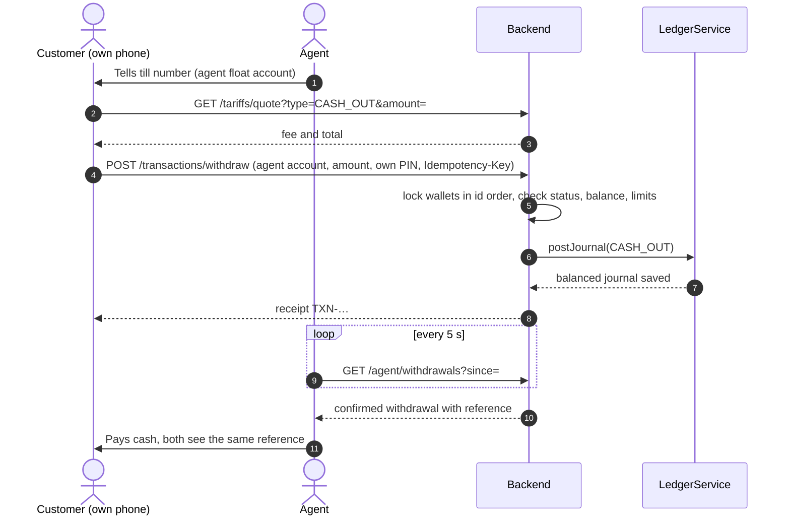

Alternative considered and not chosen (agent-initiated, customer approves):

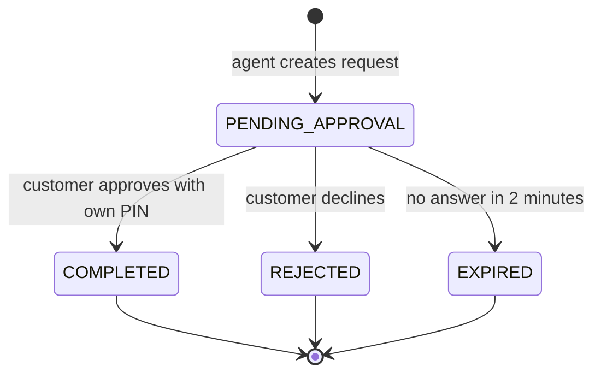

**0.2 Idempotency.** Every money `POST` (`cash-in`, `cash-out`/withdraw, transfer, treasury mint/top-up/approve) requires an `Idempotency-Key` header. New table `idempotency_keys(user_id, key, endpoint, request_hash, response_json, status, created_at)` with a unique `(user_id, key)`. Same key + same body → stored response; same key + different body → 409.

Request handling:

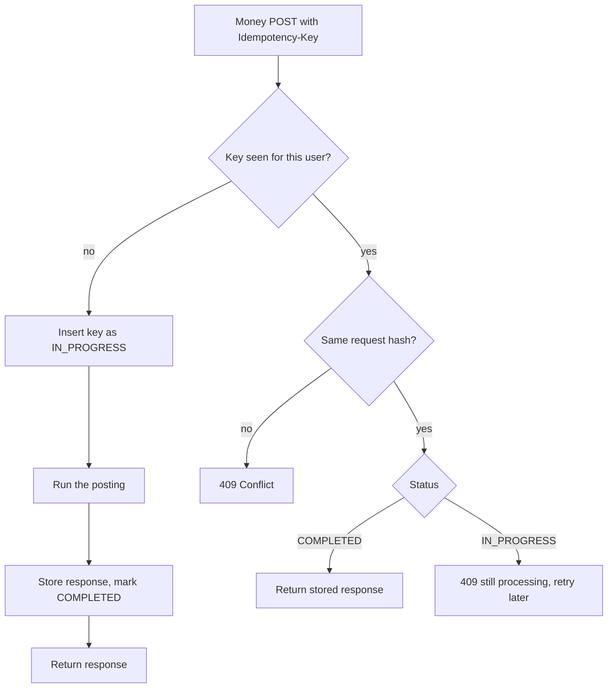

**0.3 Lock ordering.** Wallets locked in one posting are fetched in ascending `id` order *(my call)* so two concurrent postings over the same wallets cannot deadlock.

**0.4 Tests.** `TransactionService` gets unit tests for every rule it enforces (statuses, PIN, balances, tariff legs, journal balance) and one integration test per flow asserting the journal sums to zero and balances moved as expected.

**0.5 Drift fixes.** Frontend registration posts to `/api/v1/customers/register`; frontend role `CASHIER` → `AGENT`; backend permission `CASHIER_VIEW` → `AGENT_VIEW` via a migration that renames it in place.

**0.6 Real data on screens.** One API client module in the frontend (base URL, bearer token, refresh-on-401 once, typed errors). Each dashboard page replaces its `data.ts` with calls to existing endpoints; where an endpoint doesn't exist yet the page shows an explicit "coming soon" state rather than sample data. Loans and any page without a backend are hidden from navigation.

**0.7 API docs.** OpenAPI generated from controllers (springdoc) and served in dev.

### Phase 1 — Customer money

- `GET /api/v1/wallets/lookup?phone=` → masked recipient name (e.g. "Amina W.") and whether they can receive. Rate-limited.
- `GET /api/v1/tariffs/quote?type=&amount=` → fee and total, used before every confirm screen.
- `POST /api/v1/transactions/transfer` (customer → customer): PIN, idempotency key, limits (below); journal debits sender amount + fee, credits receiver amount and revenue fee. New `TransactionType.TRANSFER` and `LedgerTransactionType.TRANSFER`; a tariff band seeded for it.
- `GET /api/v1/transactions/me` (paged, filter by type/date) and `GET /api/v1/transactions/{referenceNo}` (receipt; only parties to it may read it).
- Customer web: home (balance, recent activity, quick actions), send flow (recipient → amount with fee → PIN → receipt), history, receipt share, withdraw (0.1).
- **Sign-in and registration without a username** *(your decision, 25 Nov)*. Everyone signs in with **phone number + 4-digit PIN** on the web app's one sign-in page, `/login`; the frontend sends each role to its existing home (customer `/app`, agent `/agent`, staff `/console`; *26 Nov: keep today's routes and shells, no renaming*). Customer registration asks for phone, a verification code (by email for now),  names, NIDA, date of birth, email, address and PIN, **no username**: `CustomerRegistrationRequest` drops `username`, and the backend fills the unique `users.username` column with the customer's reference so the constraint still holds. The same goes for agents and staff: `AgentCreationRequest` and `StaffCreationRequest` drop `username`, staff onboard them with their phone number, and the backend fills `users.username` from the agent ID (`AG-10234`) or staff number (`ST-0005`). The one-time PIN for a new agent or staff member goes **by email for now**, as today, and by SMS once the provider is integrated *(26 Nov)*; the onboarding forms keep the email field as required.
- **Forgot PIN: customers by phone + NIDA, agents and staff by admin reset** *(25 Nov; channel and staff rule 26 Nov)*.
  - **Customers** use web `/forgot-pin` and the app in three steps: (1) phone number + last 4 digits of the NIDA number, (2) a 6-digit code (5 minutes, 5 tries, resend after 60 s) sent **by email to the address on file for now**, by SMS later, (3) a new 4-digit PIN with the same rules as registration. On success every other session is revoked and a message confirms the reset.
  - Step 1 **always answers the same way**, whether or not the pair matches: "If these details match an account, we've sent a code to the email on file." The email is not shown, masked or not, so the screen can't be used to find out who has a wallet *(26 Nov, your assistant's catch)*.
  - Endpoints change from today's `{email}` versions to `POST /auth/forgot-pin {phone, nidaLast4}`, `POST /otp/verify {phone, otp}`, `POST /auth/reset-pin {phone, otp, newPin}`; the sending stays the existing email code.
  - **Agents and staff** have no NIDA on file, so they don't self-serve. The forgot-PIN page tells them: "Agents and staff: ask your administrator to reset your PIN." An admin (for agents, operations staff with `AGENT_MANAGE`) clicks **Reset PIN** on the record: a new one-time PIN goes by email, `mustChangePin` is set, every session is revoked, and on next sign-in they go to the set-your-own-PIN screen. Each reset is written to `audit_logs`.
- **First sign-in with a one-time PIN** *(25 Nov)*. Agents and staff sign in at `/login` with their phone and the one-time PIN. When the login response has `mustChangePin: true`, the frontend goes straight to **Set your own PIN** (today's `/change-pin` route), never the dashboard; the backend already refuses everything except `/auth/change-pin`, `/auth/logout` and `/auth/status` until then. The screen asks for a new PIN and its confirmation (4 digits, not all the same, not a sequence, different from the one-time PIN). `POST /auth/change-pin {currentPin, newPin}` sets the account ACTIVE and revokes every session, so the next screen says *PIN saved* and returns to `/login`. Phase 0 fixes: the frontend must read `mustChangePin`; the controller looks the user up by email and must use the user ID from the token instead, with a test. (Checked 26 Nov: `getPassword()` returns `pinHash`, so both PIN checks already use the same field.) The one-time PIN goes by email for now.
- **Limits, tiered by Plaid KYC** *(tiering your answer; amounts my call, demo values)*: enforced in one shared `LimitService` for transfer, withdraw and bank top-up, with values read from configuration so they can change without code.

  | Tier | When | Per transaction | Daily total | Max balance |
  |---|---|---|---|---|
  | Basic | `kyc_status` ≠ VERIFIED | 200,000 TZS | 500,000 TZS | 1,000,000 TZS |
  | Verified | `kyc_status` = VERIFIED | 3,000,000 TZS | 5,000,000 TZS | 10,000,000 TZS |

  These are demo numbers. Before real money they must be replaced with the regulator's tiers.
- **Receipts** *(my call)*: shared as an image or PDF generated in the app; no public verification link (that would be an unauthenticated endpoint and a separate security decision).
- Saved recipients (`beneficiaries`) *(my call to include here; cheap and high-delight)*.

Send-money flow:

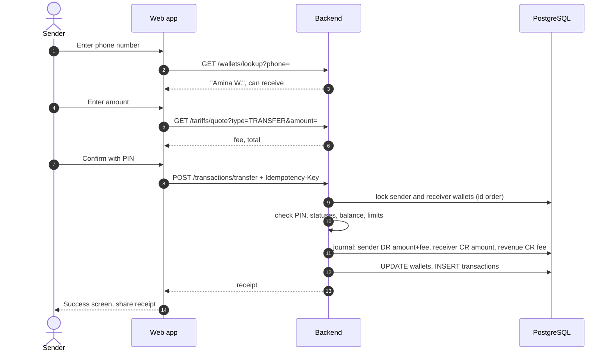

### Phase 1 — Plaid integration (Sandbox)

Plaid is the outside provider for the demo *(your decision)*. Everything runs in Plaid **Sandbox**, the free test environment that uses test people and test banks. That is enough for a portfolio and a pitch, and nothing here assumes a live Plaid contract.

**What Plaid does and doesn't cover (checked against Plaid's docs, Nov 2026)**

| Plaid product | Use here | Coverage note |
|---|---|---|
| Identity Verification (IDV): ID document, selfie, data-source checks | **KYC for customers** *(your decision)* | Verifies end users in nearly 190 countries. Buying it in Production requires the company to be based in the US, Canada or UK. Tanzania isn't on Plaid's data-source list, so Tanzanian users would go through document + selfie checks. Sandbox accepts Plaid's test persona (Leslie Knope) and custom sample identities. |
| Link + Auth + Balance (bank linking) | **"Add money from bank" demo** *(my call)* | Banks in the US, Canada and Europe only. No Tanzanian banks. |
| Transfer (ACH/RTP) | Not used | US only. The demo simulates settlement through the ledger instead. |

**KYC flow (Plaid IDV)**

1. Customer taps *Verify identity*. Backend calls `/link/token/create` with `products: ["identity_verification"]`, the IDV `template_id` and `client_user_id` = the customer's `reference`.
2. Frontend opens Plaid Link (`react-plaid-link`). The customer picks country and document, photographs it and takes a selfie.
3. On `onSuccess`, the frontend sends the Link session ID to the backend. Success here does **not** mean the person passed.
4. Backend calls `/identity_verification/get` and maps Plaid's status to `customers.kyc_status`. When deployed, a `STATUS_UPDATED` webhook to `POST /api/v1/webhooks/plaid` triggers the same fetch. Locally there's no public URL for webhooks, so the backend fetches on step 3 and on a *Refresh status* tap.
5. Verified customers move to the higher limit tier straight away (below).

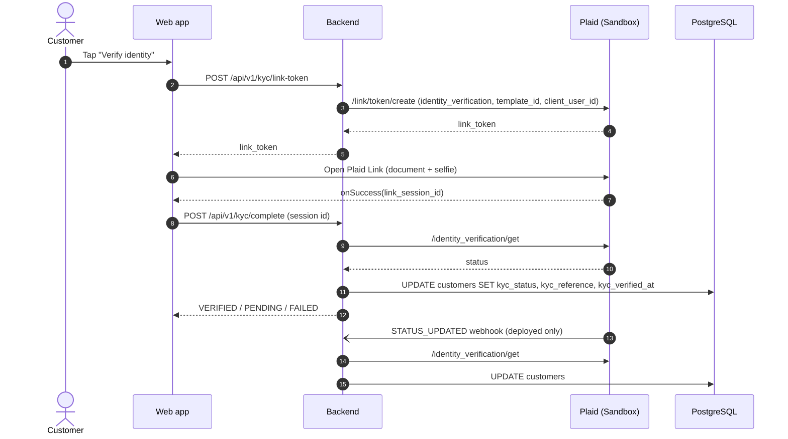

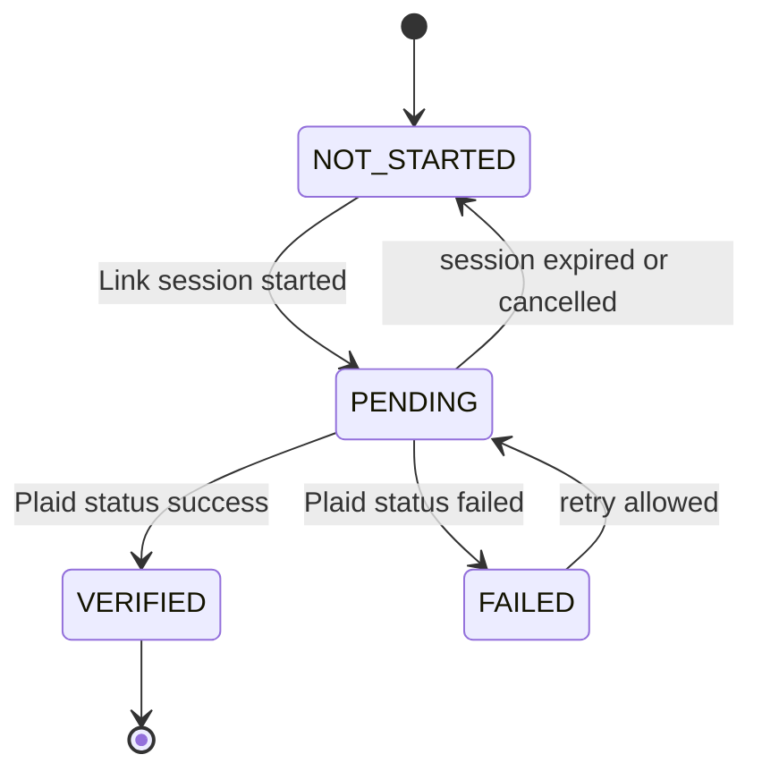

**Add money from bank (demo)** *(my call: gives the pitch a self-service funding moment next to agent cash-in)*

1. Customer links a Sandbox bank through Plaid Link (`products: ["auth"]`). The backend exchanges the `public_token` for an `access_token` and stores it encrypted.
2. Customer enters an amount. The backend checks the linked account's balance (`/accounts/balance/get`), then posts a journal **ESCROW_BANK → CUSTOMER_MAIN**, as if the bank deposit had settled into the company's escrow account. New `LedgerTransactionType.BANK_TOPUP` and `TransactionType.BANK_TOPUP`.
3. The backend posts the matching **−amount debit** on the Sandbox account with `/sandbox/transactions/create` *(25 Nov)*, so the bank side shows the money leaving. A failure here is logged and retried; it never undoes the wallet credit. `/sandbox/transactions/create` works on any Sandbox Item (checked against Plaid's docs, 26 Nov), so linking with `user_good` is fine.
   - **Sandbox name-match override** *(26 Nov)*: Sandbox banks carry Plaid's test names, which never match a WalletPesa customer, so with `PLAID_ENV=sandbox` and `plaid.sandbox.skipNameMatch=true` the own-bank check is skipped and the screen says "Demo: name check skipped in Sandbox". The override can't be switched on outside Sandbox.
4. The screen and the receipt label it *Demo: Plaid Sandbox*, so nobody mistakes it for real money. An SMS confirms the top-up (C1).

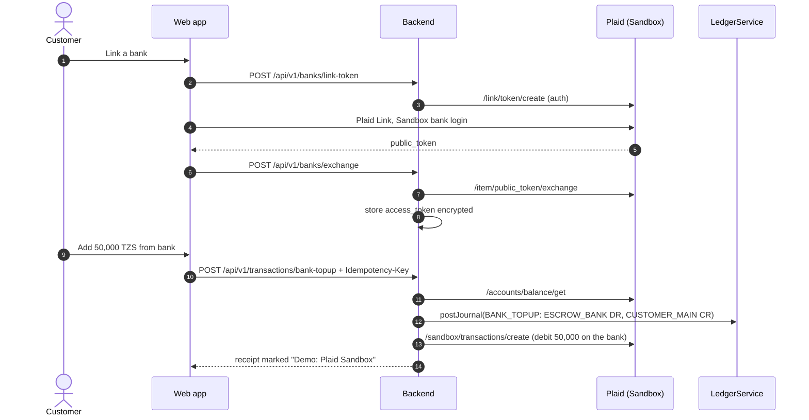

**Withdraw to own bank (demo)** *(25 Nov, your answer: option A, own bank only)*

1. Customer picks a linked bank whose name matches their verified name, enters an amount, sees the fee (1,000, from the tariff) and the total, and confirms with their PIN. Limits as for every payment.
2. `POST /api/v1/transactions/bank-withdraw` + Idempotency-Key posts **CUSTOMER_MAIN DR amount + fee, ESCROW_BANK CR amount (payout), REVENUE CR fee**, with status `PENDING`. New `TransactionType.BANK_WITHDRAWAL` and `LedgerTransactionType.BANK_WITHDRAW`.
3. The backend posts a **+amount credit** on the Sandbox account (negative amount in `/sandbox/transactions/create`) and marks the transaction `COMPLETED`. If it fails, a reversal journal returns the amount and fee to the wallet, and the transaction is marked `FAILED` (SMS C7).
4. The same endpoint shape serves agents: `POST /api/v1/agent/float/bank-withdraw` and `POST /api/v1/agent/commission/bank-withdraw` (Phase 2), with no fee.

**Data changes (new migrations)**

- `customers`: add `kyc_status varchar(20) NOT NULL DEFAULT 'NOT_STARTED'` with `CHECK (kyc_status IN ('NOT_STARTED','PENDING','VERIFIED','FAILED'))`, plus `kyc_provider varchar(20)` (`PLAID`), `kyc_reference varchar(100)` (the IDV session ID) and `kyc_verified_at timestamptz`.
- New `linked_bank_accounts` and `plaid_webhook_events` tables (DDL in *Tables to add*).

**Configuration**: `PLAID_CLIENT_ID`, `PLAID_SECRET`, `PLAID_ENV=sandbox`, `PLAID_IDV_TEMPLATE_ID`, `PLAID_WEBHOOK_URL` (deployed only) and `APP_ENCRYPTION_KEY` (for access tokens). These are secrets: they go in `.env`, never in git.

**Libraries**: `com.plaid:plaid-java` in the backend (new package `integration/plaid/`) and `react-plaid-link` in the frontend.

**Before real money** (not part of this program): Plaid can't move Tanzanian money. Production needs a Tanzanian payment or mobile-money provider for funding and payouts. KYC needs either Plaid IDV bought through a US, Canada or UK entity, or a provider that checks NIDA directly. The integration sits behind two interfaces, `KycProvider` and `FundingProvider`, so the provider can be swapped without touching wallet or ledger code *(my call)*.

### Phase 2 — Agent experience

Agent portal on the existing endpoints: cash-in, confirmed-withdrawal queue, float balance with low-float alert, float request with status timeline, daily summary, commission and transaction history. Agent locator for customers by region → district.

**Agent float** *(25 Nov, see Money movement model)*. The agent portal gets a **Float** page with two ways to top up and two ways to send money back to the bank:
- **From bank (Path A):** `POST /api/v1/agent/float/bank-topup {linkedBankId, amount, pin}` + Idempotency-Key. Checks the balance through Plaid, posts ESCROW_BANK → AGENT_FLOAT, posts the Sandbox debit, SMS A3. Daily cap **5,000,000 TZS** (configuration `agent.float.bankTopupDailyCap`); above the cap the screen points to *Request float*. New `LedgerTransactionType.FLOAT_BANK_TOPUP`.
- **Request float (Path B):** the page shows the escrow bank details and the agent's reference `AG-xxxxx`. `POST /api/v1/agent/float/requests {amount, depositReference, slip}` creates a `treasury_requests` row (`TOPUP`, `PENDING`) with the slip image; SMS A4. Staff approve or reject in the console (Phase 3); SMS A5 or A6. Existing `TOPUP_FLOAT` journal on approval.
- **Withdraw float to own bank** and **withdraw commission to own bank**: see *Withdraw to own bank* in Phase 1; SMS A7 and A8. There is no "Move commission to float".
- Agents link their business bank once through Plaid Link; the account name must match the agent's business name.

**Agent transaction history** *(added 24 Nov, your request)*. An agent can see every transaction they conducted: each cash-in they made and each customer withdrawal paid at their till.
- `GET /api/v1/agent/transactions?type=&from=&to=&q=&page=&size=` with `AGENT_VIEW`. Returns only rows where the logged-in agent's float wallet is the sender or receiver; newest first; `type` is `CASH_IN`, `CASH_OUT` or empty for both; `q` matches the reference, the customer's name or account number; `size` at most 50.
- Each row: reference, type, customer name, customer phone masked as `+255 7•• ••• 123`, customer wallet account number (`WP-0712-345678`), amount, customer fee, agent commission, status, created at.
- `GET /api/v1/agent/transactions/{reference}` returns one row with its receipt details, including the customer's full name, **full phone number** and wallet account number *(your call, 24 Nov: the list masks the phone, the detail view shows it in full)*; a reference that isn't the agent's answers 404, never 403, so references can't be probed.
- Read-only: no reversals or edits (out of scope, as for staff). The customer's PIN is never returned; the full phone number appears only in the single-transaction detail.
- Agent portal gets a **Transactions** page (search, type and date filters, paging, a detail panel with receipt download), replacing the sidebar's *Withdrawals* link. Story **US-306: Agent sees the transactions they conducted**.

### Phase 3 — Back office trust

- **Treasury with maker-checker** *(25 Nov, replaces the earlier mint plan)*. Float is issued from escrow, so `mint` is no longer a routine action.
  - **Float requests (Path B):** one staff member approves or rejects after matching the slip with the escrow statement (reference `AG-xxxxx`, amount, date). Rejection needs a reason.
  - **Commission pool refill:** REVENUE → COMMISSION, one finance staff member. The Overview shows the pool balance, the days it will last at the current rate, and a *Pool low* warning under a configured threshold. Owed commissions are paid automatically after a refill.
  - **Two approvers** (staff B ≠ staff A, new `PENDING` state) for: revenue sweep to the company bank, transaction reversal (a new opposite journal that links to the original), and treasury adjustment (corrections only, with a required reason).
  - New `LedgerTransactionType` values: `COMMISSION_POOL_REFILL`, `REVENUE_SWEEP`, `REVERSAL`, `TREASURY_ADJUSTMENT`. The old `MINT_FLOAT` stays for existing rows only; the `POST /treasury/mint` endpoint and the Company master wallet are removed *(26 Nov)*.
- Tariff management (create/edit with effective dates, no overlapping bands, quote preview). No second approval on tariffs (25 Nov).
- `audit_logs` for every staff action and status change (who, what, before/after, when).
- Daily reconciliation job: per wallet, sum of journal lines = balance; variances surface on the dashboard. V26 seeded balances without journals; because the dev database is rebuilt (Decision 3) and all money enters via mint journals, this holds from a fresh database. Any non-rebuilt environment needs an opening-balance journal migration first.
- Customer 360 for support; lock/unlock wallet with reason.
- **Agent network growth** *(added 25 Nov; design `2026-11-24-agent-network-growth-design.md`)*. Network growth is shown on Agents › Coverage by region; the staff Overview stays on money and the ledger *(changed 25 Nov, your request)*.
  - `GET /api/v1/reports/agent-network?months=12`: agents (active + suspended), new this month, active agents (a cash-in or withdrawal in the last 30 days), regions covered of 31 (at least one active agent), customers served by agents, and a monthly series of agents onboarded and active.
  - `GET /api/v1/reports/agent-network/regions?from=&to=`: per region agents, active, new in period, transactions, volume, customers served; regions with no agents included.
  - `GET /api/v1/agents/{agentId}/transactions`: staff view of the rows an agent sees in `GET /agent/transactions`.
  - New permission `NETWORK_REPORT_VIEW` (AGENT module) for ADMIN and Treasury. Can be computed nightly with the reconciliation job.
- **System settings, read-only** *(25 Nov)*: limits per tier, SMS provider status and Plaid environment, behind `SYSTEM_CONFIG`. Values stay in configuration; no editing or second approval in this release.

Two approvers (revenue sweep, reversal, treasury adjustment):

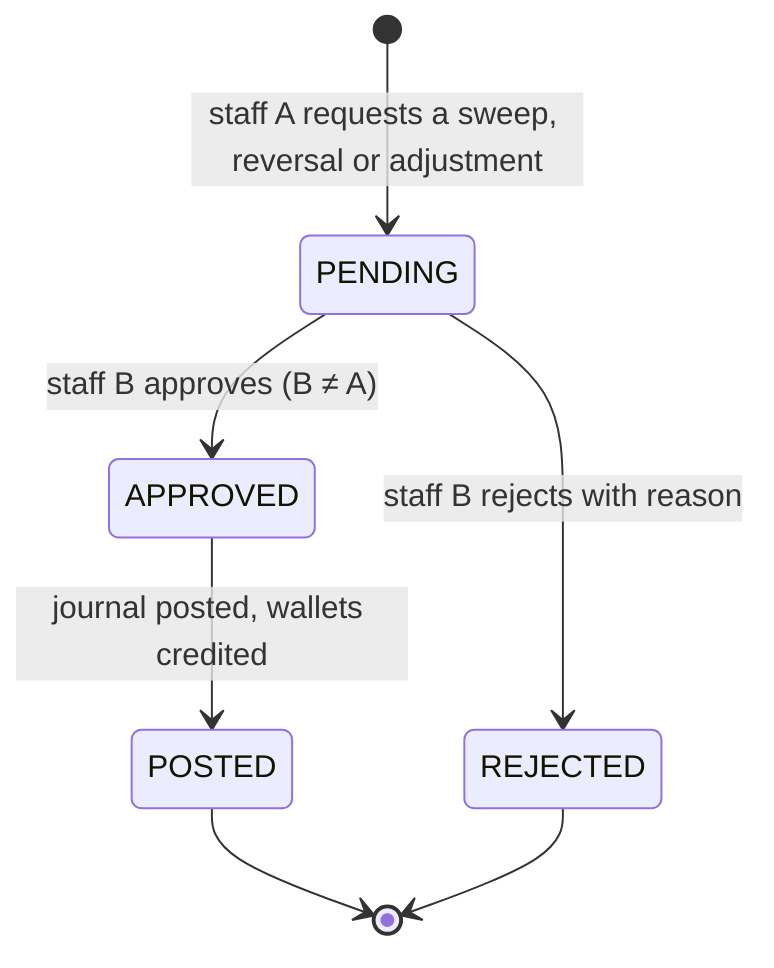

### Phase 4 — Delight

Real-time notifications (introduce SSE here, the first feature that needs push), Swahili and dark mode, plus the money features below. Each gets its own spec before it's built. None of them has an endpoint in the backend yet *(checked 26 Nov)*.

**Inside WalletPesa only (no outside partner; can start any time after Phase 1)** *(26 Nov, your request)*

| Feature | Money movement | Escrow | Endpoints to add |
|---|---|---|---|
| **Savings vaults** (goals, e.g. "School fees") | CUSTOMER_MAIN ↔ new `CUSTOMER_SAVINGS` wallet | no change | `POST /api/v1/vaults` (name, goal, optional date), `GET /api/v1/vaults`, `POST /api/v1/vaults/{id}/deposit`, `POST /api/v1/vaults/{id}/withdraw`, `DELETE /api/v1/vaults/{id}` (only when empty) |
| **Request money and QR** | None when requested; paying it is a normal wallet-to-wallet send | no change | `POST /api/v1/money-requests` (phone, amount, note), `GET /api/v1/money-requests?direction=in\|out`, `POST /api/v1/money-requests/{id}/pay` (PIN, reuses the transfer flow), `POST /api/v1/money-requests/{id}/decline`; QR encodes the account number and optional amount |
| **Statements and insights** | None: a report on the ledger | no change | `GET /api/v1/statements?month=YYYY-MM` (PDF), `GET /api/v1/insights?month=` (totals by type); built on Phase 1's `GET /api/v1/transactions/me` |

New `WalletType.CUSTOMER_SAVINGS` and `LedgerTransactionType.VAULT_DEPOSIT` / `VAULT_WITHDRAW`; a new `money_requests` table. SMS for vault moves and for money requests sent, paid or declined is added to `sms-notifications.md` with each spec.

**Needs an outside partner: later addition** *(26 Nov, your request; parked in `later.md`)*

| Feature | Real-life partner | Money movement | Escrow | Demo |
|---|---|---|---|---|
| **Bills** (electricity/LUKU tokens, water, TV, government bills) | A bill aggregator; government bills through **GePG** | CUSTOMER_MAIN → ESCROW_BANK (paid out to the biller) + REVENUE (fee) | ↓ | A "Biller simulator" labelled Demo returns a token or receipt number |
| **Airtime** | The mobile networks (Vodacom, Airtel, Yas, Halotel), usually through an aggregator | CUSTOMER_MAIN → ESCROW_BANK (paid out to the network or aggregator) | ↓ | An "Airtime simulator" labelled Demo |

These don't wait on TIPS: bills and airtime use their own partners, not the instant payment switch. They sit behind one `BillPaymentProvider` interface so the simulator can be swapped for a real partner without touching wallet or ledger code. Plaid has no part in them.

### Phase 5 — Mobile

Mobile client on the same `/api/v1`; adds only `devices` (binding, push token) and biometric unlock after a PIN login on a bound device. Shared design tokens and validation rules with web.

## Cross-cutting rules

- Every money flow sends its message through `NotificationSender` (email for now, SMS later) after the database transaction commits (never inside it), using the template keys in `sms-notifications.md`.
- Every money flow: one `@Transactional` method → lock wallets in id order → validate → move balances → `postJournal` → write `transactions` row → store idempotent response.
- Every endpoint has a permission mapped to a module; every staff action writes an audit entry (from Phase 3).
- Every UI flow works at phone width and by keyboard; copy is ready for English and Swahili.

## Engineering foundations

### System architecture

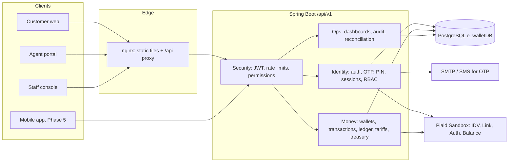


### Database (`e_walletDB`)

Everything here comes from the real schema. On 23 Nov every Flyway migration from `E-wallet-backend@84f2bc1` was replayed into PostgreSQL 16 and read back from the catalog: columns, defaults, constraints and indexes.

#### At a glance

| | |
|---|---|
| Engine | PostgreSQL 16, managed by Flyway (46 files, V1–V47; there is no V12) |
| Tables | 20: 19 application tables + `flyway_schema_history` |
| Columns / foreign keys | 175 / 23 |
| Hibernate | `ddl-auto=validate`: entities must match migrations exactly |
| Market | Tanzania: TZS currency, NIDA numbers, 31 regions and 170 districts seeded |

#### Conventions

- **Primary keys:** `id uuid` on every table, except `role_permissions` (composite `role_id, permission_id`) and Flyway's own table.
- **Public identifiers:** most tables also carry `reference uuid` (default `gen_random_uuid()`), which is safe to expose instead of `id`. Money records use readable references: `TXN-yyyyMMdd-XXXXXXXX` for transactions and `<TYPE>-yyyyMMdd-XXXXXXXX` for journals.
- **Money:** `numeric(19,2)`, never floating point. Currency is on the wallet (`TZS`).
- **Time:** `timestamptz`. The business day is `Africa/Dar_es_Salaam`.
- **Enums:** stored as `varchar` holding the Java enum name. Only a few have database `CHECK`s (agent gender, treasury status and type).
- **Profiles:** `users` holds identity and credentials only. Names and KYC live on exactly one of `customers`, `agents` or `staff` (one-to-one via a unique `user_id`).
- **Company wallets** belong to the `SYSTEM` user. A partial unique index allows exactly one each of COMPANY_MASTER_ACCOUNT, REVENUE, ESCROW_BANK and COMMISSION.

#### Entity-relationship diagram (ERD)

Renders on GitHub and in IntelliJ's Markdown preview. `PK` is a primary key, `FK` a foreign key, `UK` a unique column.

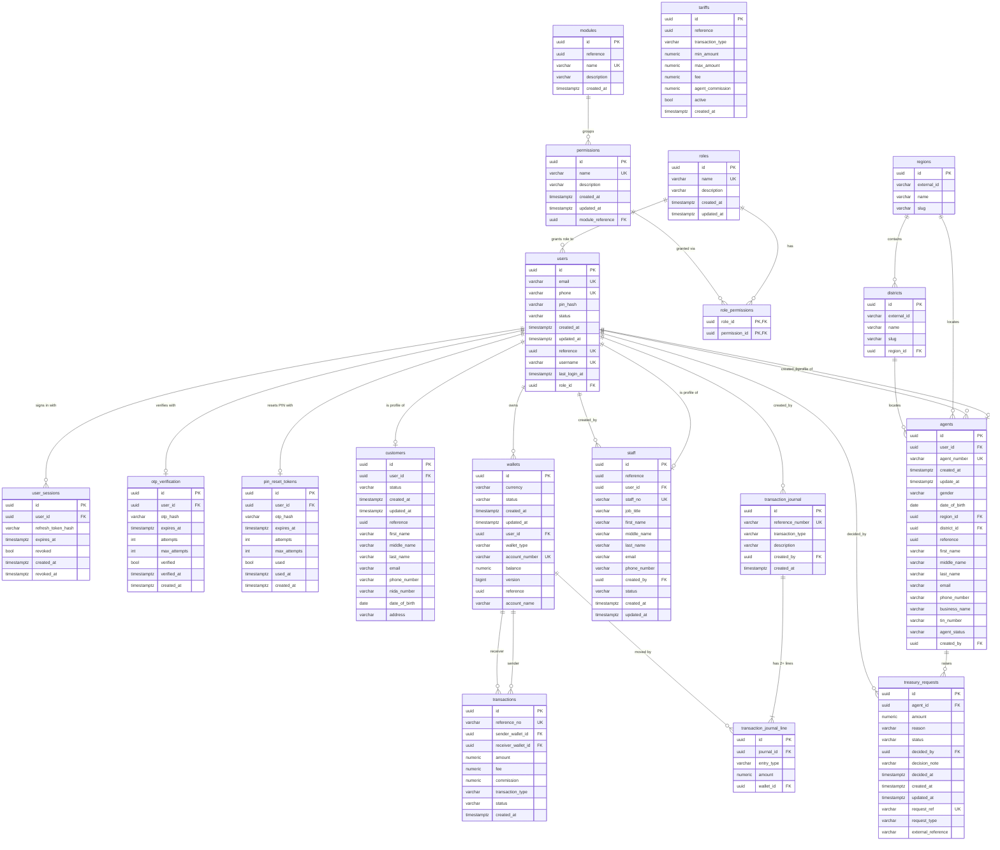

#### Domain model (UML class diagram)

The JPA entities as the code sees them: key attributes, the enums they use, and how they associate. Columns already listed in the ERD are left out unless they carry behaviour.

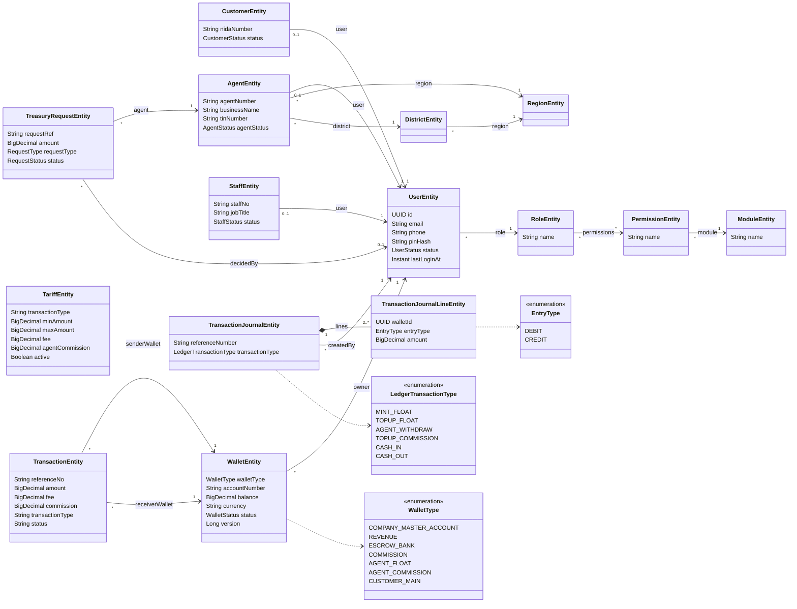

`TransactionJournalLineEntity.walletId` is a plain UUID in Java but a real foreign key in the database. The journal owns its lines (composition): they are saved and never edited with it.

#### How a posting touches the tables (UML sequence: agent cash-in today)

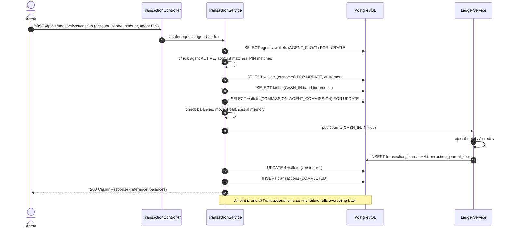

| Flow | Journal lines (debit → credit) |
|---|---|
| Cash-in | Agent float → Customer main (amount); Commission pool → Agent commission (commission) |
| Cash-out | Customer main (amount + fee) → Agent float (amount) + Revenue (fee); Commission pool → Agent commission (commission) |
| Transfer *(Phase 1)* | Customer A (amount + fee) → Customer B (amount) + Revenue (fee) |
| Bank top-up *(Phase 1, Plaid Sandbox demo)* | Escrow bank → Customer main (amount) |

#### Data dictionary

Null "yes" means the column is nullable. Key: `PK` primary key, `FK` foreign key, `UQ` unique. Enum columns name their Java enum; values are in the next table.

#### Identity & access

##### `users`

Login identity for every person and the SYSTEM account. Holds credentials (PIN hash) and one role; names live on the profile tables.

| Column | Type | Null | Default | Key | Description |
|---|---|---|---|---|---|
| `id` | uuid | no |  | PK | Primary key (UUID) |
| `email` | varchar(255) | no |  | UQ | Email; unique; used for login and OTP emails |
| `phone` | varchar(30) | no |  | UQ | Phone; unique; used for login |
| `pin_hash` | varchar(255) | yes |  |  | BCrypt hash of the 4-digit PIN; null until the PIN is set |
| `status` | varchar(30) | no |  |  | `UserStatus`: login state of the account |
| `created_at` | timestamptz | no |  |  | When the row was created |
| `updated_at` | timestamptz | no |  |  | When the row was last changed |
| `reference` | uuid | no | `gen_random_uuid()` | UQ | Public UUID safe to expose in APIs instead of `id` |
| `username` | varchar(100) | no |  | UQ | Unique username (ERD alignment; login still uses email/phone) |
| `last_login_at` | timestamptz | yes |  |  | Last successful login |
| `role_id` | uuid | no |  | FK → `roles` | The user’s single role |

Constraints & indexes: indexes: `idx_users_phone` (phone), `idx_users_email` (email)

##### `roles`

The four roles a user can have. One role per user.

| Column | Type | Null | Default | Key | Description |
|---|---|---|---|---|---|
| `id` | uuid | no |  | PK | Primary key (UUID) |
| `name` | varchar(50) | no |  | UQ | `ADMIN`, `CUSTOMER`, `AGENT`, `SYSTEM` |
| `description` | varchar(255) | yes |  |  | Human-readable description |
| `created_at` | timestamptz | no |  |  | When the row was created |
| `updated_at` | timestamptz | no |  |  | When the row was last changed |

Constraints & indexes: indexes: `idx_roles_name` (name)

##### `permissions`

Fine-grained authorities checked by `@PreAuthorize` (e.g. `FLOAT_MANAGE`). Each belongs to one module.

| Column | Type | Null | Default | Key | Description |
|---|---|---|---|---|---|
| `id` | uuid | no |  | PK | Primary key (UUID) |
| `name` | varchar(255) | no |  | UQ | Authority string, e.g. `TOPUP_CREATE` |
| `description` | varchar(255) | yes |  |  | What the permission allows |
| `created_at` | timestamptz | no |  |  | When the row was created |
| `updated_at` | timestamptz | no |  |  | When the row was last changed |
| `module_reference` | uuid | no |  | FK → `modules` | Module this permission belongs to |

Constraints & indexes: indexes: `idx_permissions_name` (name)

##### `role_permissions`

Which permissions each role grants (many-to-many).

| Column | Type | Null | Default | Key | Description |
|---|---|---|---|---|---|
| `role_id` | uuid | no |  | PK, FK → `roles` | Role |
| `permission_id` | uuid | no |  | PK, FK → `permissions` | Permission granted to the role |

Constraints & indexes: indexes: `idx_role_permissions_permission_id` (permission_id)

##### `modules`

Functional areas that group permissions (AGENT, WALLET, TREASURY…), used for menus and the role builder.

| Column | Type | Null | Default | Key | Description |
|---|---|---|---|---|---|
| `id` | uuid | no |  | PK | Primary key (UUID) |
| `reference` | uuid | no | `gen_random_uuid()` | UQ | Public UUID safe to expose in APIs instead of `id` |
| `name` | varchar(50) | no |  | UQ | Module code, e.g. `WALLET` |
| `description` | varchar(255) | no |  |  | What the module covers |
| `created_at` | timestamptz | no | `now()` |  | When the row was created |

##### `user_sessions`

One row per issued refresh token, so sessions can be listed and revoked.

| Column | Type | Null | Default | Key | Description |
|---|---|---|---|---|---|
| `id` | uuid | no |  | PK | Primary key (UUID) |
| `user_id` | uuid | no |  | FK → `users` | Owning user |
| `refresh_token_hash` | varchar(255) | no |  | UQ | Hash of the refresh token (never the token itself) |
| `expires_at` | timestamptz | no |  |  | Refresh token expiry (7 days) |
| `revoked` | boolean | no | `false` |  | True after logout, rotation or PIN reset |
| `created_at` | timestamptz | no |  |  | When the row was created |
| `revoked_at` | timestamptz | yes |  |  | When it was revoked |

Constraints & indexes: indexes: `idx_user_sessions_expires_at` (expires_at), `idx_user_sessions_user_id` (user_id)

##### `otp_verification`

The current registration/login OTP for a user (one active row per user).

| Column | Type | Null | Default | Key | Description |
|---|---|---|---|---|---|
| `id` | uuid | no |  | PK | Primary key (UUID) |
| `user_id` | uuid | no |  | FK → `users`, UQ | Owning user |
| `otp_hash` | varchar(255) | no |  |  | Hash of the 6-digit OTP |
| `expires_at` | timestamptz | no |  |  | Expiry (5 minutes) |
| `attempts` | integer | no | `0` |  | Wrong guesses so far |
| `max_attempts` | integer | no |  |  | Allowed guesses (5) |
| `verified` | boolean | no | `false` |  | True once verified |
| `verified_at` | timestamptz | yes |  |  | When verified |
| `created_at` | timestamptz | no |  |  | When the row was created |

Constraints & indexes: indexes: `idx_otp_expires_at` (expires_at), `idx_otp_user_id` (user_id)

##### `pin_reset_tokens`

The current forgot-PIN code for a user (one active row per user).

| Column | Type | Null | Default | Key | Description |
|---|---|---|---|---|---|
| `id` | uuid | no |  | PK | Primary key (UUID) |
| `user_id` | uuid | no |  | FK → `users`, UQ | Owning user |
| `otp_hash` | varchar(255) | no |  |  | Hash of the 6-digit reset code |
| `expires_at` | timestamptz | no |  |  | Expiry (5 minutes) |
| `attempts` | integer | no | `0` |  | Wrong guesses so far |
| `max_attempts` | integer | no |  |  | Allowed guesses (5) |
| `used` | boolean | no | `false` |  | True once consumed |
| `used_at` | timestamptz | yes |  |  | When consumed |
| `created_at` | timestamptz | no |  |  | When the row was created |

Constraints & indexes: indexes: `idx_pin_reset_tokens_user_id` (user_id), `idx_pin_reset_tokens_expires_at` (expires_at)

#### Parties

##### `customers`

Customer profile and KYC data for a CUSTOMER user.

| Column | Type | Null | Default | Key | Description |
|---|---|---|---|---|---|
| `id` | uuid | no |  | PK | Primary key (UUID) |
| `user_id` | uuid | no |  | FK → `users`, UQ | Owning user |
| `status` | varchar(20) | no |  |  | `CustomerStatus` |
| `created_at` | timestamptz | no |  |  | When the row was created |
| `updated_at` | timestamptz | no |  |  | When the row was last changed |
| `reference` | uuid | no | `gen_random_uuid()` | UQ | Public UUID safe to expose in APIs instead of `id` |
| `first_name` | varchar(100) | no |  |  | First name |
| `middle_name` | varchar(100) | yes |  |  | Middle name |
| `last_name` | varchar(100) | no |  |  | Last name |
| `email` | varchar(255) | no |  |  | Email address |
| `phone_number` | varchar(30) | no |  |  | Phone number in normalised international form |
| `nida_number` | varchar(30) | no |  |  | Tanzanian national ID (NIDA) number |
| `date_of_birth` | date | no |  |  | Date of birth |
| `address` | varchar(255) | no |  |  | Residential address |

##### `agents`

Agent business profile, KYC and location for an AGENT user.

| Column | Type | Null | Default | Key | Description |
|---|---|---|---|---|---|
| `id` | uuid | no |  | PK | Primary key (UUID) |
| `user_id` | uuid | no |  | FK → `users`, UQ | Owning user |
| `agent_number` | varchar(30) | no |  | UQ | Unique agent code shown to customers |
| `created_at` | timestamptz | no |  |  | When the row was created |
| `update_at` | timestamptz | no |  |  | When the row was last changed (column name lacks the "d"; see findings) |
| `gender` | varchar(10) | no |  |  | `Gender` (CHECK constrained) |
| `date_of_birth` | date | no |  |  | Date of birth |
| `region_id` | uuid | no |  | FK → `regions` | Region the agent operates in |
| `district_id` | uuid | no |  | FK → `districts` | District the agent operates in |
| `reference` | uuid | no | `gen_random_uuid()` | UQ | Public UUID safe to expose in APIs instead of `id` |
| `first_name` | varchar(100) | no |  |  | First name |
| `middle_name` | varchar(100) | yes |  |  | Middle name |
| `last_name` | varchar(100) | no |  |  | Last name |
| `email` | varchar(255) | no |  |  | Email address |
| `phone_number` | varchar(30) | no |  |  | Phone number in normalised international form |
| `business_name` | varchar(150) | no |  |  | Registered business name |
| `tin_number` | varchar(30) | no |  |  | Tax identification number (TIN) |
| `agent_status` | varchar(20) | no | `'ACTIVE'` |  | `AgentStatus`: operational standing, separate from login status |
| `created_by` | uuid | yes |  | FK → `users` | User who created this row |

Constraints & indexes: `CHECK (((gender) = ANY (['MALE', 'FEMALE', 'OTHER'][]))`

##### `staff`

Back-office profile for ADMIN/finance/support users.

| Column | Type | Null | Default | Key | Description |
|---|---|---|---|---|---|
| `id` | uuid | no |  | PK | Primary key (UUID) |
| `reference` | uuid | no | `gen_random_uuid()` | UQ | Public UUID safe to expose in APIs instead of `id` |
| `user_id` | uuid | no |  | FK → `users`, UQ | Owning user |
| `staff_no` | varchar(30) | no |  | UQ | Unique staff number |
| `job_title` | varchar(100) | no |  |  | e.g. “System Administrator” |
| `first_name` | varchar(100) | no |  |  | First name |
| `middle_name` | varchar(100) | yes |  |  | Middle name |
| `last_name` | varchar(100) | no |  |  | Last name |
| `email` | varchar(255) | no |  |  | Email address |
| `phone_number` | varchar(30) | no |  |  | Phone number in normalised international form |
| `created_by` | uuid | yes |  | FK → `users` | User who created this row |
| `status` | varchar(20) | no | `'ACTIVE'` |  | `StaffStatus` |
| `created_at` | timestamptz | no | `now()` |  | When the row was created |
| `updated_at` | timestamptz | no | `now()` |  | When the row was last changed |

#### Money & ledger

##### `wallets`

Every balance in the system: customer, agent float and commission, and four singleton company wallets. Balance changes only with journal lines.

| Column | Type | Null | Default | Key | Description |
|---|---|---|---|---|---|
| `id` | uuid | no |  | PK | Primary key (UUID) |
| `currency` | varchar(3) | no |  |  | ISO currency code (TZS) |
| `status` | varchar(20) | no |  |  | `WalletStatus` |
| `created_at` | timestamptz | no |  |  | When the row was created |
| `updated_at` | timestamptz | no |  |  | When the row was last changed |
| `user_id` | uuid | no |  | FK → `users` | Owning user |
| `wallet_type` | varchar(30) | no |  |  | `WalletType` |
| `account_number` | varchar(30) | no |  | UQ | Unique account number (customer: phone number; agent: generated code) |
| `balance` | numeric(19,2) | no |  |  | Current balance; CHECK ≥ 0 |
| `version` | bigint | no | `0` |  | Optimistic-lock version (JPA `@Version`) |
| `reference` | uuid | no | `gen_random_uuid()` | UQ | Public UUID safe to expose in APIs instead of `id` |
| `account_name` | varchar(150) | no |  |  | Display name, e.g. customer full name or “Company Revenue” |

Constraints & indexes: `CHECK ((balance >= (0)))`; indexes: `idx_wallets_wallet_type` (wallet_type); partial unique index: one wallet each of COMPANY_MASTER_ACCOUNT, REVENUE, ESCROW_BANK, COMMISSION

##### `transactions`

Customer/agent-facing record of a money movement (what a receipt or history shows).

| Column | Type | Null | Default | Key | Description |
|---|---|---|---|---|---|
| `id` | uuid | no |  | PK | Primary key (UUID) |
| `reference_no` | varchar(60) | no |  | UQ | Receipt reference `TXN-yyyyMMdd-XXXXXXXX` |
| `sender_wallet_id` | uuid | no |  | FK → `wallets` | Wallet debited |
| `receiver_wallet_id` | uuid | no |  | FK → `wallets` | Wallet credited |
| `amount` | numeric(19,2) | no |  |  | Principal amount |
| `fee` | numeric(19,2) | no | `0` |  | Fee charged to the customer |
| `commission` | numeric(19,2) | no | `0` |  | Commission paid to the agent |
| `transaction_type` | varchar(30) | no |  |  | `TransactionType` stored as text |
| `status` | varchar(20) | no |  |  | `TransactionStatus` stored as text |
| `created_at` | timestamptz | no | `now()` |  | When the row was created |

Constraints & indexes: indexes: `idx_transactions_status_created_at` (status, created_at), `idx_transactions_receiver_wallet` (receiver_wallet_id), `idx_transactions_sender_wallet` (sender_wallet_id)

##### `transaction_journal`

Double-entry journal header: one per posting. The ledger of truth.

| Column | Type | Null | Default | Key | Description |
|---|---|---|---|---|---|
| `id` | uuid | no |  | PK | Primary key (UUID) |
| `reference_number` | varchar(60) | no |  | UQ | Journal reference `<TYPE>-yyyyMMdd-XXXXXXXX` |
| `transaction_type` | varchar(30) | no |  |  | `LedgerTransactionType` |
| `description` | varchar(255) | no |  |  | Human-readable description of the posting |
| `created_by` | uuid | no |  | FK → `users` | User who triggered the posting |
| `created_at` | timestamptz | no |  |  | When the row was created |

##### `transaction_journal_line`

Debit/credit lines of a journal; debits equal credits per journal.

| Column | Type | Null | Default | Key | Description |
|---|---|---|---|---|---|
| `id` | uuid | no |  | PK | Primary key (UUID) |
| `journal_id` | uuid | no |  | FK → `transaction_journal` | Parent journal |
| `entry_type` | varchar(10) | no |  |  | `EntryType`: DEBIT or CREDIT |
| `amount` | numeric(19,2) | no |  |  | Line amount (positive) |
| `wallet_id` | uuid | no |  | FK → `wallets` | Wallet this line moves |

##### `tariffs`

Fee and agent-commission bands per transaction type and amount range.

| Column | Type | Null | Default | Key | Description |
|---|---|---|---|---|---|
| `id` | uuid | no |  | PK | Primary key (UUID) |
| `reference` | uuid | no | `gen_random_uuid()` | UQ | Public UUID safe to expose in APIs instead of `id` |
| `transaction_type` | varchar(30) | no |  |  | Transaction type the band applies to |
| `min_amount` | numeric(19,2) | no |  |  | Band lower bound (inclusive) |
| `max_amount` | numeric(19,2) | no |  |  | Band upper bound; CHECK ≥ min_amount |
| `fee` | numeric(19,2) | no |  |  | Fee charged in this band |
| `agent_commission` | numeric(19,2) | no |  |  | Commission paid to the agent in this band |
| `active` | boolean | no | `true` |  | Only active bands are used |
| `created_at` | timestamptz | no | `now()` |  | When the row was created |

Constraints & indexes: `CHECK ((max_amount >= min_amount))`

##### `treasury_requests`

Agent float top-up or withdrawal requests and the staff decision on them.

| Column | Type | Null | Default | Key | Description |
|---|---|---|---|---|---|
| `id` | uuid | no |  | PK | Primary key (UUID) |
| `agent_id` | uuid | no |  | FK → `agents` | Requesting agent |
| `amount` | numeric(19,2) | no |  |  | Requested amount; CHECK > 0 |
| `reason` | varchar(500) | no |  |  | Why the agent is asking |
| `status` | varchar(20) | no |  |  | `RequestStatus` (CHECK constrained) |
| `decided_by` | uuid | yes |  | FK → `users` | Staff user who approved or rejected |
| `decision_note` | varchar(500) | yes |  |  | Reason given with the decision |
| `decided_at` | timestamptz | yes |  |  | When decided |
| `created_at` | timestamptz | no |  |  | When the row was created |
| `updated_at` | timestamptz | no |  |  | When the row was last changed |
| `request_ref` | varchar(20) | no |  | UQ | Short public reference |
| `request_type` | varchar(20) | no |  |  | `RequestType` (CHECK constrained) |
| `external_reference` | varchar(100) | yes |  |  | Outside evidence, e.g. bank deposit slip number |
| `slip_file_key` *(new, Phase 2)* | varchar(200) | yes |  |  | Stored slip image for Path B float requests |

Constraints & indexes: `CHECK ((amount > (0)))`; `CHECK (((status) = ANY (['PENDING', 'APPROVED', 'REJECTED'][]))`; `CHECK (((request_type) = ANY (['TOPUP', 'WITHDRAWAL'][]))`; indexes: `idx_treasury_requests_agent_id` (agent_id), `idx_treasury_requests_status` (status)

#### Geography

##### `regions`

Tanzanian regions (seeded).

| Column | Type | Null | Default | Key | Description |
|---|---|---|---|---|---|
| `id` | uuid | no | `gen_random_uuid()` | PK | Primary key (UUID) |
| `external_id` | varchar(100) | no |  | UQ | ID from the source dataset |
| `name` | varchar(100) | no |  |  | Region name |
| `slug` | varchar(100) | no |  | UQ | URL-safe name |

##### `districts`

Districts within a region (seeded). Agents are placed in one.

| Column | Type | Null | Default | Key | Description |
|---|---|---|---|---|---|
| `id` | uuid | no | `gen_random_uuid()` | PK | Primary key (UUID) |
| `external_id` | varchar(100) | no |  | UQ | ID from the source dataset |
| `name` | varchar(100) | no |  |  | District name (unique within region) |
| `slug` | varchar(100) | no |  |  | URL-safe name |
| `region_id` | uuid | no |  | FK → `regions` | Region it belongs to |

Constraints & indexes: unique (region_id, name); indexes: `idx_district_region_id` (region_id)

#### Enumerations

| Enum | Values | Stored in |
|---|---|---|
| `UserStatus` | AWAITING_PIN, PIN_CHANGE_REQUIRED, ACTIVE, SUSPENDED, DISABLED, BLOCKED, CLOSED | `users.status` |
| `CustomerStatus` | PENDING, ACTIVE, SUSPENDED | `customers.status` |
| `AgentStatus` | ACTIVE, SUSPENDED, DEACTIVATED | `agents.agent_status` |
| `StaffStatus` | ACTIVE, SUSPENDED, DISABLED | `staff.status` |
| `Gender` | MALE, FEMALE, OTHER | `agents.gender` |
| `WalletType` | COMPANY_MASTER_ACCOUNT (existing rows only, 26 Nov), REVENUE, ESCROW_BANK, COMMISSION, AGENT_FLOAT, AGENT_COMMISSION, CUSTOMER_MAIN | `wallets.wallet_type` |
| `WalletStatus` | ACTIVE, SUSPENDED, BLOCKED, CLOSED | `wallets.status` |
| `TransactionType` | CASH_IN, CASH_OUT, SERVICE_FEE, SERVICE_COMMISSION (+ TRANSFER, BANK_TOPUP, BANK_WITHDRAWAL, Phase 1; FLOAT_BANK_TOPUP, FLOAT_BANK_WITHDRAWAL, COMMISSION_BANK_WITHDRAWAL, Phase 2; REVERSAL, Phase 3) | `transactions.transaction_type`, `tariffs.transaction_type` |
| `TransactionStatus` | PENDING, COMPLETED, FAILED | `transactions.status` |
| `LedgerTransactionType` | MINT_FLOAT (existing rows only), TOPUP_FLOAT, AGENT_WITHDRAW, TOPUP_COMMISSION, CASH_IN, CASH_OUT (+ TRANSFER, BANK_TOPUP, BANK_WITHDRAW, Phase 1; FLOAT_BANK_TOPUP, Phase 2; COMMISSION_POOL_REFILL, REVENUE_SWEEP, REVERSAL, TREASURY_ADJUSTMENT, Phase 3) | `transaction_journal.transaction_type` |
| `EntryType` | DEBIT, CREDIT | `transaction_journal_line.entry_type` |
| `RequestType` | TOPUP, WITHDRAWAL | `treasury_requests.request_type` |
| `RequestStatus` | PENDING, APPROVED, REJECTED | `treasury_requests.status` |
| `KycStatus` *(new, Phase 1)* | NOT_STARTED, PENDING, VERIFIED, FAILED | `customers.kyc_status` |

#### Reference and seed data

| Table | Seeded by migrations |
|---|---|
| `roles` | 4: ADMIN, CUSTOMER, AGENT, SYSTEM |
| `modules` → `permissions` | 10 modules, 36 permissions: AGENT 4, CUSTOMER 3, FINANCE 6, LOAN 4, ROLE 2, SYSTEM 1, TARIFF 3, TRANSACTION 6, USER 3, WALLET 4 |
| `regions` / `districts` | 31 / 170 |
| `tariffs` | 2 bands, 1,000 – 100,000,000 TZS: CASH_IN fee 0, commission 200; CASH_OUT fee 300, commission 200 |
| `wallets` | 4 company wallets owned by the SYSTEM user: Company Master Account, Company Revenue, Company Escrow Bank, Commission pool |
| `users` / `staff` | First admin created at startup by `DataInitializer` when `APP_INITIAL_ADMIN_ENABLED=true` |

The LOAN module's 4 permissions exist with no loan tables or endpoints. They are kept for now and hidden in the UI (Loans is a non-goal).

#### Schema findings (fix in Phase 0 unless noted)

| # | Finding | Why it matters | Proposed fix |
|---|---|---|---|
| 1 | `transaction_journal_line` has no index on `wallet_id` or `journal_id` | Reconciliation and wallet statements scan the whole table | `V48`: index both columns |
| 2 | Duplicate indexes: `users.phone`, `users.email`, `roles.name`, `permissions.name`, `otp_verification.user_id`, `pin_reset_tokens.user_id` each have a plain index next to a unique one | Extra write cost, no read benefit | Drop the plain duplicates |
| 3 | No `CHECK (amount > 0)` on `transaction_journal_line` or `transactions`; no `CHECK (fee >= 0, commission >= 0)` | A bug could post a zero or negative line that still balances | Add the checks |
| 4 | Most status/type columns have no `CHECK` (users, customers, wallets, transactions, journal) | Any string can be stored if code paths bypass the enum | Add `CHECK … IN (…)` matching each enum |
| 5 | `agents.update_at` (missing "d") while every other table uses `updated_at` | Inconsistent; easy to get wrong in queries | Rename the column and the entity mapping together |
| 6 | `customers.phone_number` and `email` are not unique, though `users.phone`/`email` are | Profile copy can drift from login identity | Keep `users` as the source of truth; add unique on `customers.phone_number` or derive it |
| 7 | `tariffs` allows overlapping bands for the same type | `findApplicableTariff` result becomes ambiguous | Enforced in service now; exclusion constraint with tariff management (Phase 3) |
| 8 | Seed balances from V26 have no journal lines | Reconciliation would show variances on an un-rebuilt database | Rebuild dev DB (decision 3); opening-balance journal for any other environment |

#### Tables to add

```sql
-- Phase 0: safe retries for money POSTs
CREATE TABLE idempotency_keys (
    id            uuid PRIMARY KEY DEFAULT gen_random_uuid(),
    user_id       uuid NOT NULL REFERENCES users(id),
    idem_key      varchar(80) NOT NULL,
    endpoint      varchar(120) NOT NULL,
    request_hash  varchar(64) NOT NULL,          -- SHA-256 of the request body
    status        varchar(20) NOT NULL CHECK (status IN ('IN_PROGRESS','COMPLETED','FAILED')),
    http_status   integer,
    response_json jsonb,
    created_at    timestamptz NOT NULL DEFAULT now(),
    UNIQUE (user_id, idem_key)
);

-- Phase 1: saved recipients
CREATE TABLE beneficiaries (
    id                 uuid PRIMARY KEY DEFAULT gen_random_uuid(),
    owner_user_id      uuid NOT NULL REFERENCES users(id),
    wallet_id          uuid NOT NULL REFERENCES wallets(id),
    nickname           varchar(60),
    last_used_at       timestamptz,
    created_at         timestamptz NOT NULL DEFAULT now(),
    UNIQUE (owner_user_id, wallet_id)
);

-- Phase 3: who did what
CREATE TABLE audit_logs (
    id           uuid PRIMARY KEY DEFAULT gen_random_uuid(),
    actor_id     uuid REFERENCES users(id),
    action       varchar(60) NOT NULL,           -- e.g. WALLET_LOCK, TARIFF_UPDATE
    entity_type  varchar(60) NOT NULL,
    entity_id    uuid,
    before_json  jsonb,
    after_json   jsonb,
    reason       varchar(500),
    ip_address   varchar(45),
    created_at   timestamptz NOT NULL DEFAULT now()
);
CREATE INDEX idx_audit_logs_entity ON audit_logs (entity_type, entity_id);
CREATE INDEX idx_audit_logs_actor_created ON audit_logs (actor_id, created_at);

-- Phase 1: Plaid bank linking (Sandbox demo)
CREATE TABLE linked_bank_accounts (
    id                     uuid PRIMARY KEY DEFAULT gen_random_uuid(),
    user_id                uuid NOT NULL REFERENCES users(id),
    provider               varchar(20) NOT NULL DEFAULT 'PLAID',
    provider_item_id       varchar(100) NOT NULL,
    access_token_encrypted text NOT NULL,          -- AES-GCM with APP_ENCRYPTION_KEY
    provider_account_id    varchar(100) NOT NULL,
    institution_name       varchar(150),
    account_mask           varchar(10),            -- last 4 digits only
    status                 varchar(20) NOT NULL DEFAULT 'ACTIVE' CHECK (status IN ('ACTIVE','REVOKED')),
    created_at             timestamptz NOT NULL DEFAULT now(),
    UNIQUE (user_id, provider_account_id)
);
CREATE INDEX idx_linked_bank_accounts_user ON linked_bank_accounts (user_id);

-- Phase 1: Plaid webhooks, stored once so a retry is never processed twice
CREATE TABLE plaid_webhook_events (
    id            uuid PRIMARY KEY DEFAULT gen_random_uuid(),
    webhook_type  varchar(50) NOT NULL,
    webhook_code  varchar(50) NOT NULL,
    object_id     varchar(100) NOT NULL,          -- e.g. identity_verification_id
    payload       jsonb NOT NULL,
    received_at   timestamptz NOT NULL DEFAULT now(),
    processed_at  timestamptz,
    UNIQUE (webhook_type, webhook_code, object_id, received_at)
);
```

Later: `devices` (binding, push token; Phase 5), `notifications` (Phase 4), `savings_vaults`, `payment_requests` and `billers` (Phase 4, each with its own spec).

#### Schema rules

- Never edit or rename a merged migration. The next file is `V48`, and each file makes one change.
- A PR that adds a migration also updates the matching entity (`ddl-auto=validate` fails otherwise).
- Balances change only in the same DB transaction as their journal lines. Reversals are new opposite journals; nothing is updated or deleted.
- New status/type columns get a `CHECK` matching their enum. New money columns get sign checks.
- Every new foreign key gets an index.

### Project structure

Both repos are organised by feature. Lines marked `+` are proposed by this design; `-` marks what to remove.

**Backend**: `Abuu37/E-wallet-backend` · Spring Boot 4.2 · Java 21 · Maven

```
e-wallet-backend/
├─ pom.xml                       JPA, Security, Flyway, Mail, JJWT, Bucket4j, libphonenumber
├─ .env.example                  DB, admin seed, SMTP, JWT_SECRET
├─ + Dockerfile
├─ + .github/workflows/ci.yml
├─ docs/superpowers/{specs,plans}/
└─ src/main/java/com/application/e_wallet/
   ├─ auth/  otp/  security/          login, PIN, refresh, OTP, SecurityConfig, JWT, DataInitializer
   ├─ user/  role/  permission/  module/
   ├─ customer/  agent/  staff/
   ├─ wallet/                         7 wallet types, PESSIMISTIC_WRITE locks
   ├─ ledger/                         LedgerService.postJournal (rejects unbalanced)
   ├─ transaction/                    cash-in, cash-out (+ transfer, history, receipts)
   ├─ treasury/                       mint, commission top-up, float requests
   ├─ tariff/  location/  dashboard/{admin,agent}/
   ├─ common/                         exceptions, validation, events
   ├─ + idempotency/                  Idempotency-Key filter + idempotency_keys
   ├─ + limit/                        LimitService (per-transaction and daily)
   ├─ + audit/                        audit_logs (Phase 3)
   ├─ + integration/plaid/            KycProvider + FundingProvider via plaid-java, webhook controller
   └─ + config/OpenApiConfig.java     springdoc
   src/main/resources/db/migration/   V1…V47, next V48
   src/test/java/…                    11 classes, 74 tests (+ TransactionServiceTest)
```

Inside each feature: `controller/ dto/ entity/ repository/ service/`. DTOs are records named `*Request`/`*Response`, errors go through `common/exception/GlobalExceptionHandler`, and every money flow posts through `LedgerService`.

**Frontend**: `Abuu37/E-wallet-frontend` · React 19 · Vite 8 · TypeScript · Tailwind 4

```
e-wallet-frontend/
├─ .env  .env.production         VITE_API_BASE_URL only (no secrets)
├─ + Dockerfile  nginx.conf
├─ + .github/workflows/ci.yml
└─ src/
   ├─ App.tsx                    routes: public, /dashboard (staff/agent), /account (customer)
   ├─ + lib/api/client.ts        base URL, bearer token, refresh-on-401 once, typed errors
   ├─ components/                Guard, context, layout, ui
   ├─ pages/                     Home, services, Fees, FAQ, Contact
   └─ features/
      ├─ auth/                   register, login, forgot PIN (live API)
      ├─ account/                customer overview, withdraw
      ├─ overview/ transactions/ customers/ ledger/ reconciliation/ fees/ financial/ wallets/ settings/
      ├─ cashiers/  → rename to agents/
      ├─ - loans/                hide until it has a backend and spec
      ├─ - */data.ts             mock data, replaced by per-feature api.ts
      ├─ + send-money/  + history/  + agent/
      ├─ + kyc/  + banks/            Plaid Link (react-plaid-link): verify identity, link bank, add money
```

Frontend conventions to adopt: all HTTP goes through `src/lib/api`, never `fetch` inside components. Each feature owns `api.ts`, `types.ts` and `pages/`. Convert `.jsx` to `.tsx` as files are touched. Role names match the backend (`ADMIN`, `AGENT`, `CUSTOMER`).

**Mobile (Phase 5)**: a third repo, `E-wallet-mobile`, on the same `/api/v1`, sharing design tokens and validation rules.

### Docker

Neither repo has Docker today. The proposal is one Compose stack for local and staging, and the same images for production.

| Service | Image | Port | Role |
|---|---|---|---|
| `frontend` | nginx:alpine (built from node:22-alpine) | 80 | Serves `dist/` and proxies `/api/` to the backend, so there's no CORS in production |
| `backend` | eclipse-temurin:21-jre (built with maven:3.9-eclipse-temurin-21) | 8080 | Runs Flyway on start, then validates entities |
| `db` | postgres:16-alpine | 5432, volume `pgdata` | `e_walletDB`, health-checked before the backend starts |
| `mail` (dev only) | axllent/mailpit | SMTP 1025, UI 8025 | Catches OTP emails locally |

How the containers connect:

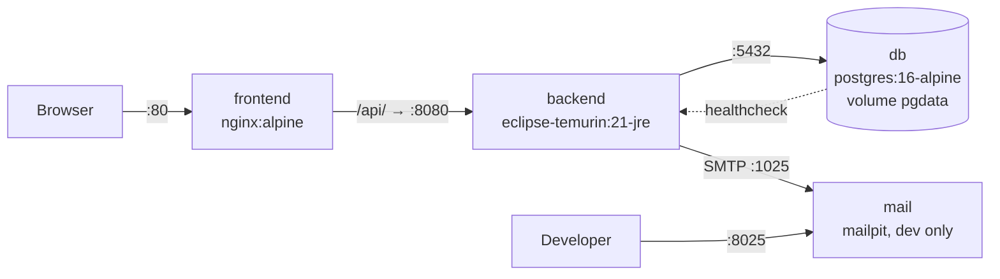

`docker-compose.yml`:

```yaml
services:
  db:
    image: postgres:16-alpine
    environment:
      POSTGRES_DB: e_walletDB
      POSTGRES_USER: ${DB_USERNAME}
      POSTGRES_PASSWORD: ${DB_PASSWORD}
    volumes: [pgdata:/var/lib/postgresql/data]
    healthcheck:
      test: ["CMD-SHELL", "pg_isready -U ${DB_USERNAME}"]
      interval: 5s
      retries: 10
  mail:
    image: axllent/mailpit
    ports: ["8025:8025"]
  backend:
    build: ./e-wallet-backend
    env_file: .env
    environment:
      DB_URL: jdbc:postgresql://db:5432/e_walletDB
      APP_MAIL_HOST: mail
      APP_MAIL_PORT: 1025
    depends_on:
      db: { condition: service_healthy }
    ports: ["8080:8080"]
  frontend:
    build: ./e-wallet-frontend
    depends_on: [backend]
    ports: ["80:80"]
volumes:
  pgdata:
```

`e-wallet-backend/Dockerfile`:

```dockerfile
FROM maven:3.9-eclipse-temurin-21 AS build
WORKDIR /app
COPY pom.xml mvnw ./
COPY .mvn .mvn
RUN ./mvnw -q dependency:go-offline
COPY src src
RUN ./mvnw -q -DskipTests package

FROM eclipse-temurin:21-jre
WORKDIR /app
RUN useradd -r wallet
USER wallet
COPY --from=build /app/target/*.jar app.jar
EXPOSE 8080
ENTRYPOINT ["java", "-jar", "app.jar"]
```

`e-wallet-frontend/Dockerfile` and `nginx.conf`:

```dockerfile
FROM node:22-alpine AS build
WORKDIR /app
COPY package*.json ./
RUN npm ci
COPY . .
ARG VITE_API_BASE_URL=/api/v1
RUN npm run build

FROM nginx:alpine
COPY nginx.conf /etc/nginx/conf.d/default.conf
COPY --from=build /app/dist /usr/share/nginx/html
```

```nginx
server {
  listen 80;
  location /api/ { proxy_pass http://backend:8080; }
  location / {
    root /usr/share/nginx/html;
    try_files $uri /index.html;
  }
}
```

Where the Compose file lives is left to the builder. It can sit in the backend root with the frontend as a sibling folder, or in a small third repo.

### Environments and configuration

| Environment | How it runs |
|---|---|
| Local | `docker compose up`, or IntelliJ + `npm run dev` against the `db` container. The database can be dropped and rebuilt at any time. |
| Staging | Same images, deployed from `main` after CI passes. Seeded test agents and customers. Used for demos. |
| Production | Same images, tagged releases only. Managed PostgreSQL with daily backups, a real SMTP or SMS gateway, secrets from the host's secret store, HTTPS at the edge. |

| Setting | Notes |
|---|---|
| `DB_URL`, `DB_USERNAME`, `DB_PASSWORD` | Per environment |
| `JWT_SECRET` | 256-bit random, different in every environment |
| `APP_MAIL_HOST/PORT/USER/PASS` | SMTP for OTP; Mailpit locally |
| `APP_INITIAL_ADMIN_*` | Seeds the first admin; enable only on a fresh database |
| `VITE_API_BASE_URL` | Frontend build-time; `/api/v1` behind nginx |
| `PLAID_CLIENT_ID`, `PLAID_SECRET`, `PLAID_ENV` | Plaid keys; `sandbox` for the demo |
| `PLAID_IDV_TEMPLATE_ID` | Identity Verification template from the Plaid Dashboard |
| `PLAID_WEBHOOK_URL` | Public HTTPS URL for Plaid webhooks (deployed only) |
| `APP_ENCRYPTION_KEY` | Encrypts stored Plaid access tokens |

The backend ignores `.env` and commits `.env.example`. The frontend commits `.env` and `.env.production`, which hold only the public API URL. No secrets go in either repo.

### Git workflow

Today both repos commit straight to `main` with free-form messages and no CI.

- **`main` is protected and always deployable.** Merges require a pull request and passing CI.
- **Short-lived branches**, one story or fix each, named `feature/US-202-send-money`, `fix/…`, `docs/…` or `chore/…`. There is no long-lived `develop` branch *(my call; small team)*.
- **The flow:** branch from `main` → failing test, then code → push and open a PR that links the story and spec → CI green → one review (a person or Claude code review) → squash merge → delete the branch.
- **Conventional Commits:** `feat(transfer): …`, `fix(cash-out): …`, `test(…)`, `docs: …`, `refactor(…)`, `chore(ci): …`.
- **Releases:** tag `main` as `v0.x.y` when a phase ships. Docker images get the same tag, and release notes are generated from commit types.
- **This design** is committed on `docs/flagship-program-design`. Pushing needs the Claude GitHub App on both repos.

What the history looks like:

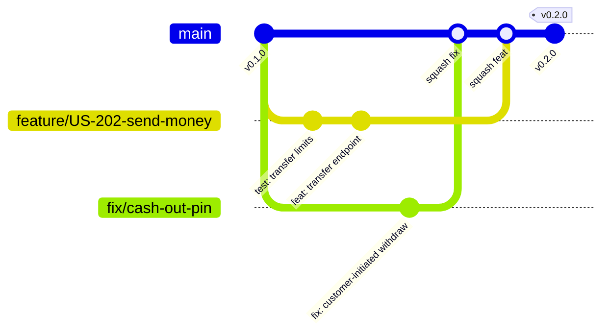

### CI (GitHub Actions)

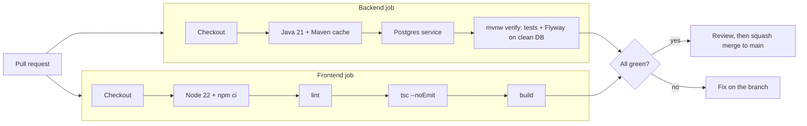

Backend `.github/workflows/ci.yml`:

```yaml
on: [pull_request, push]
jobs:
  build:
    runs-on: ubuntu-latest
    services:
      postgres:
        image: postgres:16-alpine
        env: { POSTGRES_DB: e_walletDB, POSTGRES_PASSWORD: test }
        ports: ["5432:5432"]
    steps:
      - uses: actions/checkout@v4
      - uses: actions/setup-java@v4
        with: { distribution: temurin, java-version: 21, cache: maven }
      - run: ./mvnw -B verify
        env:
          DB_URL: jdbc:postgresql://localhost:5432/e_walletDB
          DB_USERNAME: postgres
          DB_PASSWORD: test
          JWT_SECRET: ci-only-not-a-real-secret
```

Frontend `.github/workflows/ci.yml`:

```yaml
on: [pull_request, push]
jobs:
  build:
    runs-on: ubuntu-latest
    steps:
      - uses: actions/checkout@v4
      - uses: actions/setup-node@v4
        with: { node-version: 22, cache: npm }
      - run: npm ci
      - run: npm run lint
      - run: npx tsc --noEmit
      - run: npm run build
```

### Testing, observability and security baseline

- **Testing:**
  - Unit tests use JUnit 5 + Mockito; there are 74 today, and every money rule gets one.
  - Integration tests use Testcontainers PostgreSQL and assert that journals sum to zero.
  - Frontend tests use Vitest + Testing Library.
  - Playwright end-to-end tests cover register, send, cash-in and withdraw.
- **Observability:** Spring Boot Actuator `/health` for Docker and uptime checks; JSON logs to stdout in containers (today: `logs/app.log`); a request ID echoed in error responses; the daily reconciliation result shown on the admin dashboard.
- **Security:** containers run as a non-root user; HTTPS everywhere outside local; Bucket4j rate limits (already a dependency) on OTP, login and recipient lookup; Dependabot on both repos; no secrets in git.

## What's left to the builder

- Exact migration numbering and order after V47.
- DTO shapes beyond the fields named here, following existing `*Request`/`*Response` records.
- Frontend component breakdown and state management inside each page, following the current feature-folder layout.
- Polling intervals (suggested 5 s for withdrawal confirmation, 30 s for dashboards).

## Answers and remaining question

| # | Question | Answer (23 Nov) |
|---|---|---|
| 1 | What is it for? | Portfolio project and pitch demo; real money later. Plaid as the API provider for now. |
| 2 | Approach | **C**: short safety fix, then visible wins (confirmed). |
| 3 | Withdrawal model | Customer-initiated, as recommended. |
| 4 | Limits | Tiered by Plaid KYC result; demo amounts in Phase 1. |
| 5 | Push access | You'll connect the Claude GitHub App. |
| 6 | Agent transactions | Agents can see the transactions they conducted (24 Nov): Phase 2, `GET /agent/transactions`. |
| 7 | Staff console story | The agent network is growing (25 Nov): Phase 3 network growth report, Coverage by region, staff view of one agent's transactions. Design: `2026-11-24-agent-network-growth-design.md`. |
| 8 | Username | No username for anyone (customers, agents, staff); sign in with phone + PIN at `/login` (25 Nov). |
| 9 | Forgot PIN | By phone + last 4 NIDA digits and an SMS code, not email (25 Nov). |
| 10 | Money movement | Every wallet shilling is backed by escrow; float is issued from escrow, not minted (25 Nov). See *Money movement model*. |
| 11 | Customer cash-out | At an agent, or to their **own** linked bank, fee 1,000 (25 Nov). Sending to someone else's bank is parked for later. |
| 12 | Send money | Wallet to wallet now; other mobile networks (MNOs) later, through TIPS (25 Nov). |
| 13 | Agent float | Path A from own bank, automatic, 5,000,000 TZS a day; Path B deposit slip with one staff approval (25 Nov). |
| 14 | Commission | Paid automatically from a commission pool that finance refills, with a *Pool low* warning (25 Nov). |
| 15 | SMS | SMS for every money movement and security event; list in `sms-notifications.md` (25 Nov). |
| 16 | Phase 4 money features | Savings vaults, request money and statements stay inside WalletPesa and can start after Phase 1; bills and airtime need outside partners and are a later addition (26 Nov). |
| 17 | Notifications | Email for now for codes, one-time PINs and money alerts, through `NotificationSender`; SMS later (26 Nov). |
| 18 | Company master | Removed: float from escrow, pool refills from Revenue, adjustments Escrow ↔ Revenue (26 Nov). |
| 19 | Agent and staff forgot PIN | Admin resets it; a new one-time PIN goes by email (26 Nov). |
| 20 | Routes | Keep today's `/app`, `/agent`, `/console` and `/change-pin` (26 Nov). |

**Still needed from you:** approve this document. After that, the next step is a step-by-step build plan for Phase 0.

**Setup you'll need for Plaid:** a free Plaid Dashboard account, Sandbox keys, Identity Verification enabled for Sandbox (Products page → *Enable Sandbox*; Plaid may ask for a product-access request), and an IDV template.
